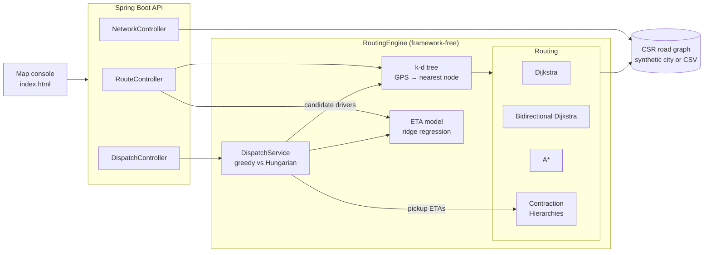

# RouteWise

**A road-network routing and delivery-dispatch engine in Java 17 + Spring Boot.** It answers the three questions every food-delivery and ride-hailing backend answers millions of times a day:

1. **What is the fastest route?** Four shortest-path algorithms, from textbook Dijkstra to **Contraction Hierarchies**, the technique behind production route planners such as OSRM and GraphHopper.
2. **How long will it actually take?** A **learned ETA model** (ridge regression with time-of-day Fourier features) that turns free-flow route time into a rush-hour-aware prediction.
3. **Which driver should take which order?** Optimal fleet assignment with the **Hungarian algorithm**, benchmarked against the greedy strategy simple dispatchers use.

Every core data structure and algorithm is implemented from scratch: CSR graph, indexed binary heap with decrease-key, k-d tree, Tarjan's SCC, Dijkstra, bidirectional Dijkstra, A*, Contraction Hierarchies, the Hungarian algorithm, and the regression solver. Spring Boot is only the HTTP layer.


*The same 18 km query on a 10,000-intersection city. Yellow dots are nodes each algorithm had to explore. Dijkstra floods the map, A\* is pulled toward the target, and Contraction Hierarchies climb a precomputed hierarchy and touch 72 nodes.*

---

## Headline results

Measured on a 2-core Intel Xeon VM; reproduce with the [benchmark runner](#benchmarks).

| | Result |
|---|---|
| Contraction Hierarchies vs Dijkstra, 40k-node city | **160x fewer nodes settled, 33x faster** (81 µs vs 2.7 ms per query) |
| Correctness | All four algorithms return identical travel times on every benchmark and test query |
| ETA model vs best constant-multiplier baseline | **69% lower error** (MAE 56 s vs 184 s, MAPE 7.1%) |
| Hungarian vs greedy dispatch, 5:30 pm rush | **7.3% less total pickup time**, worst-case pickup 21 → 14 min, better in 30/30 scenarios |

## Architecture



**Request flow for a dispatch:** a k-d tree shortlists the 8 nearest drivers per order by straight-line distance. Each shortlisted pair is priced with a Contraction Hierarchies route plus the ETA model. Greedy and Hungarian assignment then run on the same price table.

## Algorithms

| Component | Algorithm | Complexity | Where |
|---|---|---|---|
| Graph storage | Compressed sparse row, forward + reverse | O(V + E) memory, sequential edge scans | `graph/Graph.java` |
| Priority queue | Indexed binary heap with decrease-key | O(log n) insert / decrease / poll | `ds/IndexedMinHeap.java` |
| Connectivity | Tarjan's SCC, iterative (no recursion) | O(V + E) | `graph/Connectivity.java` |
| Baseline routing | Dijkstra | O((V + E) log V) | `routing/Dijkstra.java` |
| | Bidirectional Dijkstra | same bound, ~half the search | `routing/BidirectionalDijkstra.java` |
| | A* with consistent straight-line heuristic | same bound, goal-directed | `routing/AStar.java` |
| Fast routing | Contraction Hierarchies: edge-difference ordering with lazy updates, bounded witness search, stall-on-demand, iterative shortcut unpacking | seconds of preprocessing, ~100 settled nodes per query | `routing/ContractionHierarchy.java` |
| Spatial index | 2-d tree, quickselect median build, bounded max-heap k-NN | O(n log n) build, O(log n) query | `ds/KdTree.java` |
| Assignment | Hungarian (Kuhn-Munkres with potentials), rectangular | O(n²m) | `dispatch/HungarianAlgorithm.java` |
| ETA | Ridge regression via normal equations + Gaussian elimination | O(nd² + d³) | `eta/RidgeRegression.java` |

See [docs/ALGORITHMS.md](docs/ALGORITHMS.md) for how each one works and why it is correct.

## Quick start

**Requirements:** JDK 17+ and Maven 3.9+, or Docker.

```bash
# Run the API and the map console on http://localhost:8080
mvn spring-boot:run

# or with Docker
docker compose up --build
```

Startup generates a 10,000-intersection city, builds the contraction hierarchy (~1.5 s) and trains the ETA model (~0.5 s). Then open **http://localhost:8080**:

- **Route tab:** click an origin and a destination. All four algorithms run; pick one to see its search space, compare settled nodes and latency, and move the departure-time slider to watch the ETA change.
- **Dispatch tab:** simulate drivers and orders and toggle between the greedy and optimal assignments.

| Route console | Dispatch console |
|---|---|
|  |  |

## API

| Method | Endpoint | Purpose |
|---|---|---|
| GET | `/api/route` | Fastest route between two coordinates |
| GET | `/api/route/compare` | Same query through all four algorithms |
| POST | `/api/dispatch` | Assign your drivers to your orders (greedy and optimal) |
| POST | `/api/dispatch/simulate` | Random dispatch scenario on the current map |
| GET | `/api/network/summary` | Network size, CH statistics, ETA metrics |
| GET | `/api/network` | Node and segment arrays for drawing the map |
| GET | `/api/eta/model` | ETA model evaluation metrics |
| GET | `/actuator/health` | Health check |

```bash
# Route at evening rush hour with A*
curl "http://localhost:8080/api/route?fromLat=40.715&fromLon=-74.000&toLat=40.790&toLon=-73.900&algorithm=astar&hour=17.5"
```

```json
{
  "algorithm": "A_STAR",
  "found": true,
  "distanceMeters": 16715.7,
  "freeFlowSeconds": 836.0,
  "predictedEtaSeconds": 1979.6,
  "settledNodes": 3817,
  "queryMicros": 840.1,
  "coordinates": [[40.7156, -73.9994], "... 112 points"]
}
```

*Response abridged; it also includes `fromNode`, `toNode` and `searchSpace`. Empty roads would take 14 minutes; at 5:30 pm the model predicts 33.*

`algorithm` accepts `dijkstra`, `bidirectional`, `astar` or `ch` (default). `hour` is the departure time in [0, 24) and defaults to now; add `weekend=true` for weekend traffic and `searchSpace=true` to get every explored node.

```bash
# Dispatch your own fleet
curl -X POST http://localhost:8080/api/dispatch \
  -H "Content-Type: application/json" \
  -d '{
        "drivers": [{"id": "d1", "lat": 40.72, "lon": -73.99}, {"id": "d2", "lat": 40.76, "lon": -73.95}],
        "orders":  [{"id": "o1", "lat": 40.75, "lon": -73.96}],
        "hour": 12.0
      }'
```

The response has a `greedy` and an `optimal` result (assignments, total, average and worst pickup ETA), the number of pairs that were routed, and the time saved by the optimal assignment.

Invalid input (unknown algorithm, hour outside [0, 24), missing parameters, duplicate ids) returns `400` with a JSON error message.

## Benchmarks

```bash
mvn -q compile
java -cp target/classes com.routewise.bench.BenchmarkRunner 50,100,200 1000
```

Each algorithm answers the same 1,000 random queries after a JIT warm-up, and the runner aborts if any algorithm disagrees with Dijkstra. Results from a 2-core Intel Xeon @ 2.8 GHz VM:

| City | Nodes | Edges | Algorithm | Avg settled nodes | Avg query (µs) | p50 (µs) | p99 (µs) | Speed-up vs Dijkstra |
|---|---:|---:|---|---:|---:|---:|---:|---:|
| 50x50 | 2,500 | 7,481 | Dijkstra | 1,262 | 124.8 | 122.0 | 264.3 | 1.0x |
| | | | Bidirectional Dijkstra | 611 | 101.1 | 80.4 | 424.5 | 1.2x |
| | | | A* | 534 | 157.5 | 118.2 | 565.8 | 0.8x |
| | | | **Contraction Hierarchies** | **57** | **21.0** | 19.5 | 67.6 | **5.9x** |
| 100x100 | 9,995 | 30,130 | Dijkstra | 5,053 | 590.3 | 595.7 | 1,409.3 | 1.0x |
| | | | Bidirectional Dijkstra | 2,677 | 386.9 | 320.5 | 1,254.7 | 1.5x |
| | | | A* | 1,945 | 434.0 | 313.4 | 1,719.5 | 1.4x |
| | | | **Contraction Hierarchies** | **86** | **48.0** | 34.6 | 112.7 | **12.3x** |
| 200x200 | 39,988 | 121,536 | Dijkstra | 20,027 | 2,712.4 | 2,674.4 | 5,611.0 | 1.0x |
| | | | Bidirectional Dijkstra | 12,237 | 2,054.5 | 1,740.9 | 6,543.7 | 1.3x |
| | | | A* | 7,456 | 1,995.4 | 1,364.0 | 8,123.0 | 1.4x |
| | | | **Contraction Hierarchies** | **125** | **81.3** | 77.4 | 188.2 | **33.4x** |

CH preprocessing: 0.5 s / 1.6 s / 7.4 s for the three sizes, adding about 1.1 shortcuts per original edge.

**What the numbers show**

- The CH speed-up **grows with network size**: settled nodes rise from 57 to 125 while Dijkstra's rise from 1,262 to 20,027. On continental networks with millions of nodes this gap reaches three to four orders of magnitude.
- A* settles 2.7x fewer nodes than Dijkstra but is only ~1.4x faster: each settled node pays for a haversine evaluation, and on a grid whose highways are 3x faster than side streets the straight-line heuristic (which must assume highway speed everywhere) is loose.
- CH query times include unpacking shortcuts back into real road segments, so the returned path is directly drawable.

**ETA model** (held-out 20% of 6,000 simulated trips, 100x100 city):

| Predictor | MAE (s) |
|---|---:|
| Free-flow travel time | 272.1 |
| Free-flow x best single global multiplier | 183.9 |
| **Ridge regression with time-of-day features** | **56.2** (RMSE 78.1, MAPE 7.1%) |

**Dispatch** (40 drivers, 35 orders, 5:30 pm, 30 random scenarios):

| Strategy | Avg total pickup ETA | Avg worst pickup |
|---|---:|---:|
| Greedy (globally nearest pair first) | 209.2 min | 21.1 min |
| **Hungarian (optimal)** | **194.0 min** | **14.4 min** |

Greedy's failure mode is visible in the worst-case column: taking the closest pair first can strand a later order with a distant driver.

## Design decisions

- **Framework-free core.** Everything under `graph`, `routing`, `ds`, `eta` and `dispatch` is plain Java with no dependencies; Spring only wires `RoutingEngine` into controllers. Tests and benchmarks run the core without starting a server.
- **CSR graph instead of `List<List<Edge>>`.** Flat primitive arrays, no per-edge objects, cache-friendly adjacency scans, plus a reverse CSR so backward searches don't need a second graph.
- **Thread-local, reset-on-touch search spaces.** Each algorithm reuses its `dist`/`parent` arrays per thread and resets only the entries a query touched. Allocating O(n) arrays per request would cost more than an entire CH query.
- **Admissible A\* even on imperfect data.** The heuristic speed is the maximum straight-line speed over all edges, not the posted speed limit, so the heuristic stays consistent even if imported edge lengths are inaccurate.
- **Witness-search limits trade memory for time, never correctness.** When a bounded witness search gives up, CH adds the shortcut anyway: the graph gets slightly larger, but distances stay exact.
- **Closed-form ridge regression.** About 90 features, so the normal equations solve in milliseconds with no learning rate or epoch count to tune. Features are standardised and the intercept is not penalised.
- **Fair dispatch comparison.** Both strategies use one shared price cache; greedy falls back to unshortlisted drivers instead of leaving orders unassigned, and the Hungarian solver sees every pair greedy priced. The optimal total is therefore never worse than greedy's for the same orders, which a unit test asserts.
- **Simulated traffic is a stand-in, by design.** `TrafficSimulator` plays the role of historical GPS logs. The model only ever sees (features, observed time) pairs, so swapping in real trip logs needs no model changes.

## Using a real road network

The engine loads any network expressed as two CSV files, such as an OpenStreetMap extract exported with a tool like OSMnx:

```text
nodes.csv:  id,lat,lon                          ids 0..n-1, in order
edges.csv:  from,to,length_m,time_s,road_class  road_class = RESIDENTIAL | ARTERIAL | HIGHWAY
```

```bash
mvn spring-boot:run -Dspring-boot.run.arguments="--routewise.network.nodes-csv=/data/nodes.csv --routewise.network.edges-csv=/data/edges.csv"
```

The loader keeps the largest strongly connected component, so one-way dead ends in the source data can't create unroutable pockets. `GraphIO.write` exports any graph, including the synthetic city, in the same format.

## Testing

```bash
mvn verify
```

| Test class | What it proves |
|---|---|
| `ShortestPathAlgorithmsTest` | All four algorithms agree with Dijkstra on random graphs with one-way streets and unreachable pairs, and on generated cities; every returned path is made of real edges; speed-up techniques settle fewer nodes (CH at least 10x fewer) |
| `IndexedMinHeapTest` | 20,000 random operations match a reference model |
| `KdTreeTest` | Nearest and k-nearest queries match brute force; duplicates and empty inputs |
| `GraphTest` | CSR construction, reverse CSR consistency, Tarjan's SCC on a known graph, generator determinism and connectivity, CSV round trip |
| `DispatchTest` | Hungarian matches brute-force enumeration on 300 random rectangular matrices; optimal never loses to greedy; the classic greedy trap; unreachable orders |
| `EtaModelTest` | Ridge recovers a known linear function; Gaussian elimination; the trained model beats both baselines and predicts rush hour slower than night |
| `ApiIntegrationTest` | Boots the app and exercises every endpoint, including validation errors and the health check |

GitHub Actions runs the full build, the tests and a small benchmark on every push.

## Project structure

```text
src/main/java/com/routewise
├── RouteWiseApplication.java
├── api/          REST controllers and error handling
├── config/       Spring wiring for the engine
├── engine/       RoutingEngine facade and API result types
├── graph/        CSR graph, builder, city generator, CSV I/O, Tarjan SCC, geo helpers
├── routing/      Dijkstra, bidirectional Dijkstra, A*, Contraction Hierarchies
├── ds/           Indexed min-heap, k-d tree
├── eta/          Trip features, traffic simulator, feature encoder, ridge regression, ETA model
├── dispatch/     Hungarian algorithm, dispatch service, domain records
└── bench/        Benchmark runner
src/main/resources/static/index.html   Map console (vanilla JS + canvas, no build step)
```

## Roadmap

- Turn restrictions and turn costs via an edge-based graph
- Customizable Contraction Hierarchies so live traffic can update weights without re-contracting
- ALT (landmarks + triangle inequality) as a tighter A* heuristic
- Batched dispatch over time windows, with order-ready times and driver capacity
- Gradient-boosted trees for the ETA model, trained on real trip logs

## License

MIT. See [LICENSE](LICENSE).
